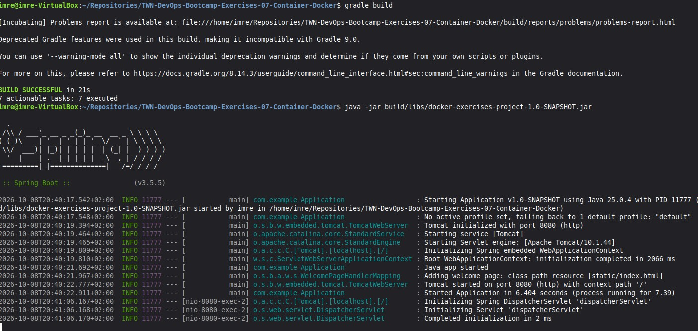
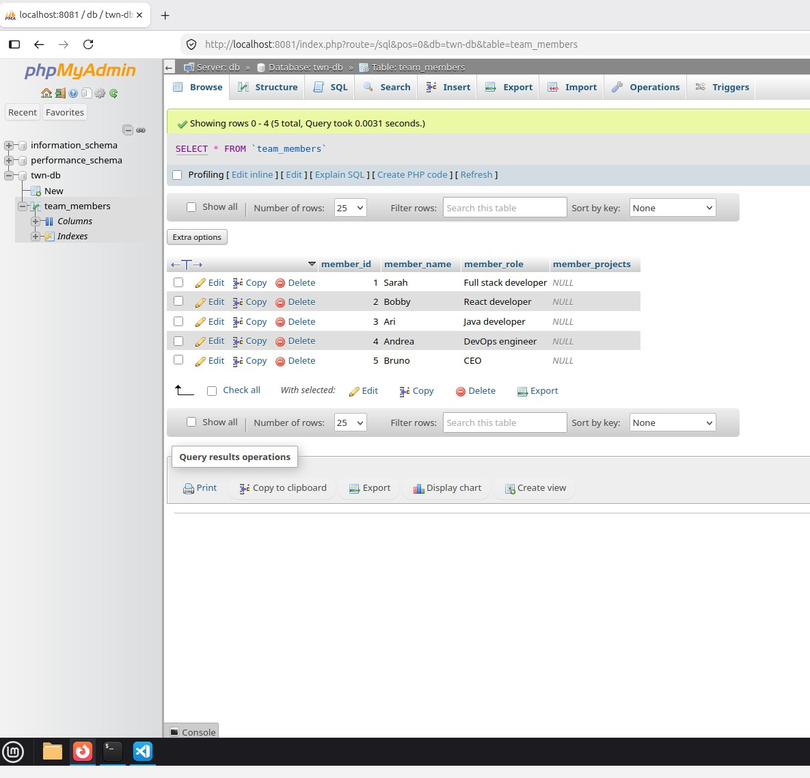
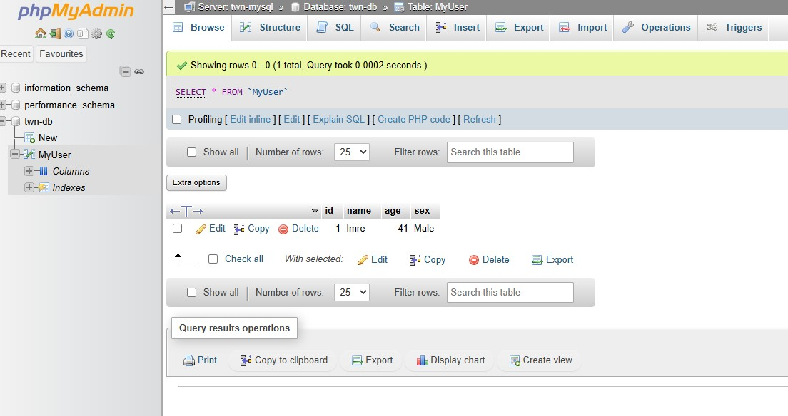
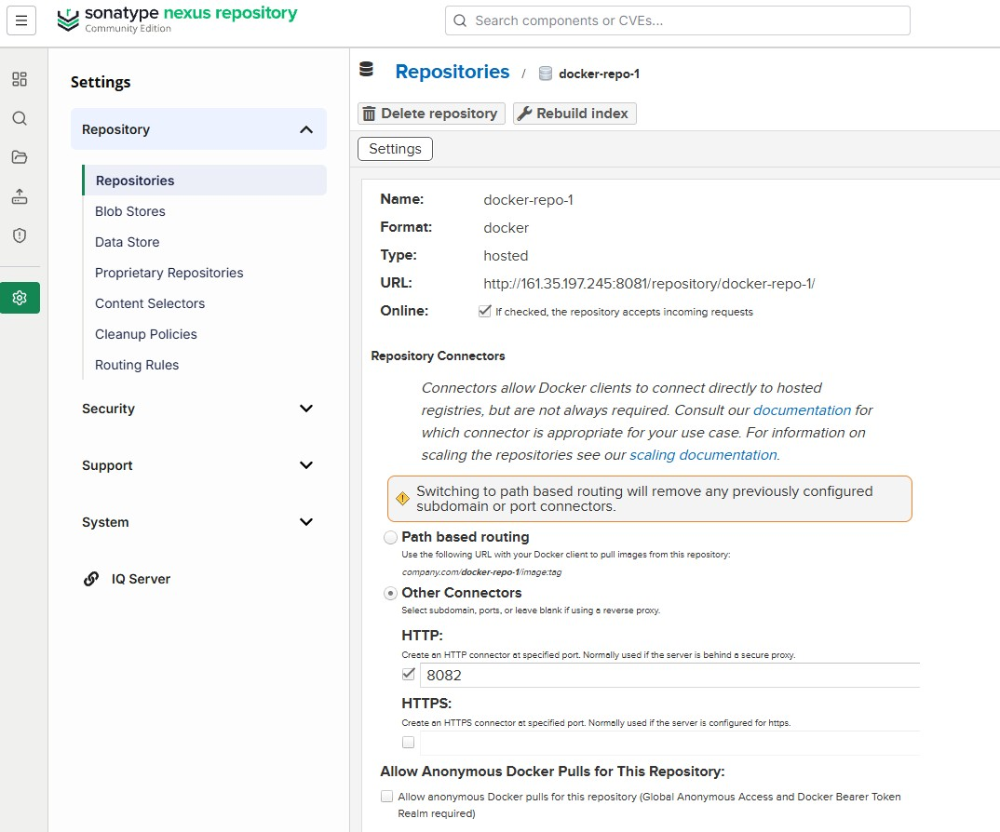
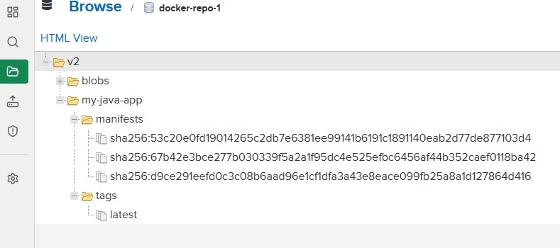

# Solutions for Exercises-07 Container-with-Docker

## Exercise 0

```bash
# Navigate to the working directory.
cd Repositories

# Cloning.
git clone https://gitlab.com/twn-devops-bootcamp/latest/07-docker/docker-exercises.git

# Deleting .git folder.
rm -rf docker-exercises/.git

# Renaming the folder, because I want to save it to my GitHub repository with a different name.
mv docker-exercises TWN-DevOps-Bootcamp-Exercises-07-Container-Docker
cd TWN-DevOps-Bootcamp-Exercises-07-Container-Docker

git init
git status

# Commit & push.
git add .
git commit -m "Initial commit"
git branch -M main
git remote add origin https://github.com/ImreBodnar/TWN-DevOps-Bootcamp-Exercises-07-Container-Docker.git
git push -u origin main
```

## Exercise 1

**At first let's install Docker:**

```bash
sudo apt update
sudo apt install docker.io

# I added myself to the docker group to avoid permission issues.
sudo usermod -aG docker MY_USER_NAME
# After this I had to restart my virtual machine.
```

**Let's start a MySQL container:**

```bash
docker run -p 3306:3306 \
--name twn-mysql \
-e MYSQL_ROOT_PASSWORD=1q2w3e4r \
-e MYSQL_DATABASE=twn-db \
-e MYSQL_USER=admin \
-e MYSQL_PASSWORD=q1w2e3r4 \
-d mysql:26.7
```

> I used intentionally a fixed version for MySQL instead of the latest tag.

**Export the neccessary environment variables, build and run the app:**

```bash
export DB_USER=admin
export DB_PWD=q1w2e3r4
export DB_SERVER=localhost
export DB_NAME=twn-db

cd ~/Repositories/TWN-DevOps-Bootcamp-Exercises-07-Container-Docker/
gradle build

java -jar build/libs/docker-exercises-project-1.0-SNAPSHOT.jar
```

**Result of build and run:**



## Exercise 2

**Let's run a PHPMyAdmin container:**

```bash
docker run -p 8081:80 \
--name twn-phpmyadmin \
--link twn-mysql:db \
-d phpmyadmin:5.2.3
```

> I used intentionally a fixed version for PHPMyAdmin instead of the latest tag.

**I successfully logged in to the PHPMyAdmin UI:**



## Exercise 3

**At first I had to install docker-compose:**

```bash
sudo apt install docker-compose-v2
docker compose version
```

**The content of a docker compose file to run both containers:**

```yaml
version: "3.9"
name: twn-dc

services:
  mysql.db:
    image: mysql:26.7
    container_name: twn-mysql
    environment:
      - MYSQL_ROOT_PASSWORD=1q2w3e4r
      - MYSQL_DATABASE=twn-db
      - MYSQL_USER=admin
      - MYSQL_PASSWORD=q1w2e3r4
    ports:
      - 3306:3306
    volumes:
      - mysql_data:/var/lib/mysql

  phpmyadmin.ui:
    image: phpmyadmin:5.2.3
    container_name: twn-phpmyadmin
    environment:
      - PMA_HOST=twn-mysql
    ports:
      - 8081:80

volumes:
  mysql_data:
```

**I used this command to run my docker compose:**

```bash
docker compose -f ./docker-compose.yaml up -d
```

**The PhpMyAdmin UI after I created and restarted my docker compose:**
**(Before the restart I created a table with one row as you can see in the picture.)**



## Exercise 4

**I added Dockerfile to the project:**

```yaml
FROM openjdk:17.0.2-jdk

RUN mkdir app
WORKDIR /app

COPY build/libs/docker-exercises-project-1.0-SNAPSHOT.jar myapp.jar

EXPOSE 8080

CMD ["java","-jar","myapp.jar"]
```

## Exercise 5

**At first I created a Docker hosted repository for my Docker images:**



**I used these commands for the tasks:**

```bash
gradle build

docker build -t my-java-app:latest .
docker tag my-java-app:latest NEXUS_ADDRESS:8082/my-java-app:latest
```

**I created /etc/docker/daemon.json file which contains these lines:**

```json
{
    "insecure-registries": ["NEXUS_ADDRESS:8082"]
}
```

**After that I restarted Docker:**

```bash
sudo systemctl restart docker
```

**I had to add a new inbound rule to my DigitalOcean Droplet firewall to grant access (TCP 8082).**
**And finally, login and push:**

```bash
docker login NEXUS_ADDRESS:8082

docker push NEXUS_ADDRESS:8082/my-java-app:latest
```

**The pushed Docker Image:**



## Exercise 6

**At first let's set some environment variables:**

```bash
# MySQL related variables
export MYSQL_ROOT_PASSWORD=********
export DB_USER=********
export DB_PWD=********
export DB_SERVER=mysql.db
export DB_NAME=twn-db

# Nexus related variables
export NEXUS_USER=********
export NEXUS_PWD=********
export NEXUS_ADDRESS=xxx.xxx.xxx.xxx:8082

echo $NEXUS_PWD | docker login -u $NEXUS_USER --password-stdin $NEXUS_ADDRESS

docker compose -f docker-compose.yaml up
```

**This is the updated docker-compose.yaml:**

```yaml
version: "3.9"
name: twn-dc

services:
  mysql.db:
    image: mysql:26.7
    container_name: twn-mysql
    environment:
      - MYSQL_ROOT_PASSWORD=${MYSQL_ROOT_PASSWORD}
      - MYSQL_DATABASE=${DB_NAME}
      - MYSQL_USER=${DB_USER}
      - MYSQL_PASSWORD=${DB_PWD}
    ports:
      - 3306:3306
    volumes:
      - mysql_data:/var/lib/mysql
    healthcheck:
      test: [ "CMD", "mysqladmin", "ping", "-h", "localhost" ]
      interval: 10s
      timeout: 5s
      retries: 5
      start_period: 30s

  phpmyadmin.ui:
    image: phpmyadmin:5.2.3
    container_name: twn-phpmyadmin
    environment:
      - PMA_HOST=${DB_SERVER}
    ports:
      - 8081:80
    depends_on:
      - mysql.db

  my-java-app:
    image: xxx.xxx.xxx.xxx:8082/my-java-app:latest
    container_name: twn-java-app
    environment:
      - DB_USER=${DB_USER}
      - DB_PWD=${DB_PWD}
      - DB_SERVER=${DB_SERVER}
      - DB_NAME=${DB_NAME}
    ports:
      - 8080:8080
    depends_on:
      mysql.db:
        condition: service_healthy

volumes:
  mysql_data:
```

## Exercise 7

**At first I updated line 48 in index.html.**
**After that I used these commands:**

> Important! To run my newly build container in docker-compose I used my Jenkins server droplet.

```bash
gradle build

docker build -t my-java-app:1.11 .
docker tag my-java-app:1.1 NEXUS_ADDRESS:8082/my-java-app:1.11

docker login NEXUS_ADDRESS:8082
docker push NEXUS_ADDRESS:8082/my-java-app:1.11

scp -i ~/.ssh/digital_ocean_key docker-compose.yaml root@JENKINS_ADDRESS:/root/

ssh -i ~/.ssh/digital_ocean_key root@JENKINS_ADDRESS

# I had to instal docker-compose first.
apt install docker-compose-v2

# I updated the "insecure-registries" line.
nano /etc/docker/daemon.json
service docker restart
docker info

# MySQL related variables
export MYSQL_ROOT_PASSWORD=********
export DB_USER=********
export DB_PWD=********
export DB_SERVER=mysql.db
export DB_NAME=twn-db

# Nexus related variables
export NEXUS_USER=********
export NEXUS_PWD=********
export NEXUS_ADDRESS=xxx.xxx.xxx.xxx:8082

echo $NEXUS_PWD | docker login -u $NEXUS_USER --password-stdin $NEXUS_ADDRESS

docker compose -f docker-compose.yaml up
```
